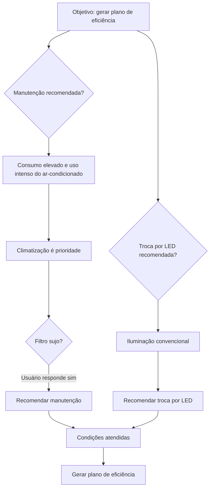

# Energia Expert ⚡

**Sistema especialista para análise do consumo de energia elétrica residencial**

## Sobre o projeto

O **Energia Expert** é uma proposta acadêmica de sistema especialista que utiliza regras lógicas para analisar informações de uma residência e sugerir medidas de eficiência energética. A ideia é ajudar o morador a identificar possíveis desperdícios, sem substituir uma avaliação técnica.

> **Status:** projeto conceitual, com simulação das regras e do mecanismo de inferência. Ainda não há uma aplicação implementada.

## Objetivo

Demonstrar como um sistema especialista pode usar fatos e regras do tipo **SE–ENTÃO** para recomendar ações relacionadas ao consumo de eletricidade.

### Componentes do sistema

- **Interface do usuário:** recebe informações sobre a residência.
- **Base de conhecimento:** guarda os fatos e as regras.
- **Motor de inferência:** verifica as condições e produz recomendações.

## Três fatos iniciais

Para a simulação, consideramos uma residência com estas características:

```text
consumo_elevado = TRUE
uso_intenso_ar_condicionado = TRUE
iluminacao_convencional = TRUE
```

Ou seja, o consumo está acima do habitual, o ar-condicionado é usado por muitas horas e a residência utiliza lâmpadas convencionais.

## Cinco regras SE–ENTÃO

**Regra 1 — Climatização**  
SE o consumo estiver elevado **E** o ar-condicionado for muito utilizado, **ENTÃO** considerar a climatização uma prioridade de análise.

**Regra 2 — Manutenção**  
SE a climatização for uma prioridade **E** o filtro do ar-condicionado estiver sujo, **ENTÃO** recomendar a manutenção do aparelho.

**Regra 3 — Iluminação**  
SE a residência utilizar iluminação convencional, **ENTÃO** recomendar a substituição por lâmpadas LED adequadas.

**Regra 4 — Modo de espera**  
SE o consumo estiver elevado **E** houver aparelhos consumindo energia desnecessariamente em modo de espera (*standby*), **ENTÃO** recomendar a redução desse consumo.

**Regra 5 — Plano de eficiência**  
SE a manutenção do ar-condicionado **E** a troca das lâmpadas forem recomendadas, **ENTÃO** gerar um plano de eficiência energética.

## Simulação: *Backward Chaining*

No **encadeamento para trás**, o sistema parte de um objetivo e verifica quais fatos são necessários para confirmá-lo.

**Objetivo:** `gerar_plano_eficiencia = TRUE`

1. O sistema consulta a **Regra 5** e identifica duas condições: recomendar manutenção do ar-condicionado e troca das lâmpadas.
2. Pela **Regra 1**, o uso intenso do ar-condicionado e o consumo elevado tornam a climatização uma prioridade.
3. Para aplicar a **Regra 2**, ainda é preciso saber se o filtro está sujo. O sistema pergunta ao usuário, que responde **sim**.
4. Com o novo fato `filtro_ar_sujo = TRUE`, a **Regra 2** recomenda a manutenção.
5. Como a residência utiliza iluminação convencional, a **Regra 3** recomenda a troca por LED.
6. As duas condições da **Regra 5** são atendidas, e o plano pode ser gerado.



### Resultado da simulação

- Realizar a limpeza e a manutenção do ar-condicionado.
- Avaliar a substituição das lâmpadas convencionais por modelos LED adequados.

A **Regra 4** poderá produzir outra recomendação se o usuário informar que há consumo desnecessário em modo de espera.

## Limitações

O sistema depende das informações fornecidas pelo usuário e das regras definidas na base de conhecimento. Ele não mede o consumo elétrico, não identifica sozinho a causa de uma conta elevada e não calcula a economia em reais. Por isso, suas respostas são orientações iniciais, não diagnósticos definitivos.

## Conclusão

O Energia Expert demonstra como uma base de conhecimento e um motor de inferência podem ser utilizados em um problema cotidiano. Com três fatos iniciais e cinco regras, a simulação mostra o caminho percorrido pelo sistema para chegar a recomendações de eficiência energética.

## Referência

Material didático da aula **Sistemas Especialistas**, da disciplina de Inteligência Artificial e Linguagens Formais e Autômatos, fornecido para a atividade acadêmica.
